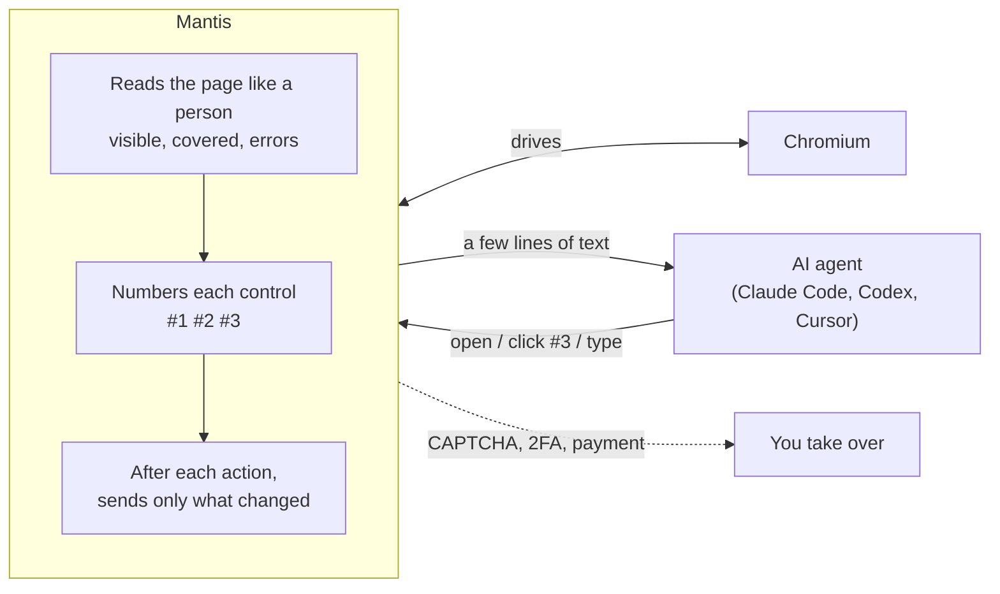

# Mantis

**Lets AI agents browse the web as short, numbered text instead of screenshots.**

Mantis shows the agent what a person would notice on a page, in a few lines, and lets it act by number.
It plugs into Claude Code, Codex, Cursor or your own agent as an MCP server.

## How it works



## Quick start

Requires Node 20+.

```bash
npx playwright install chromium
claude mcp add mantis -- npx -y -p mantis-browser mantis-mcp
```

On native Windows: `claude mcp add mantis -- cmd /c npx -y -p mantis-browser mantis-mcp`

Try it without an agent: `npx -y -p mantis-browser mantis read https://example.com`

## What the agent sees

A shop page with a cookie popup:

```
Page: Shop
[dialog "Accept cookies?" — covers page]
  #3 button "Accept"
  #4 button "Reject"
[main]
  # Shop
  #1 button "Add to cart" (covered)
  #2 link "More products" (covered)
```

After `click #3`, only the changes come back:

```
clicked #3 button "Accept"
~ #1 button "Add to cart": no longer covered
~ #2 link "More products": no longer covered
- [dialog "Accept cookies?"] closed (3 items)
```

The agent can read, search, click, type, pick options, fill a whole form in one call, scroll and go back,
and pull values out of charts and images. Mantis never solves CAPTCHAs.

## Results

30 real-site tasks, Codex `gpt-6-luna` as the agent, graded by a blind judge (`gpt-6.1-sol`):

| | Correct | Tokens per task | Tool calls | Time per task |
|---|---:|---:|---:|---:|
| **Mantis** | **14/30** | **190k** | **8.7** | **61s** |
| Accessibility tree (Playwright MCP) | 11/30 | 435k | 13.3 | 67s |
| Screenshots | 9/30 | 346k | 22.2 | 77s |

Method and caveats: [bench/RESULTS.md](bench/RESULTS.md).

## Learn more

- [How it works in detail](docs/APPROACH.md)
- [Claude skill](skill/README.md): teaches Claude how to read Mantis output
- [Setup, configuration and tool reference](docs/SETUP.md)
- [Re-running the benchmarks](bench/README.md)

## License

MIT
