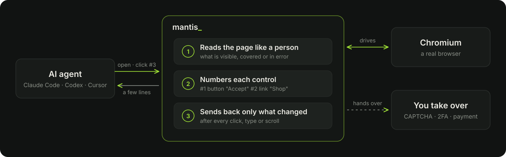
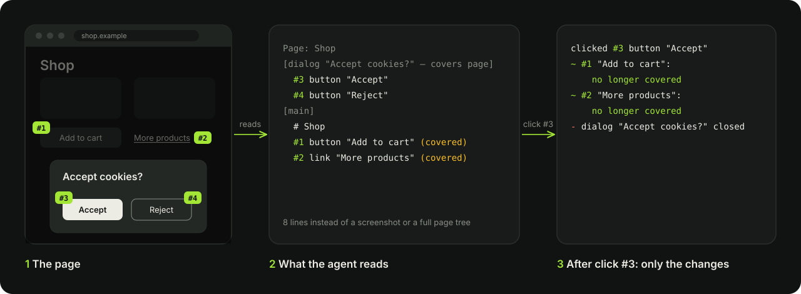

**Lets AI agents browse the web as short, numbered text instead of screenshots.**

[perzian.dev/mantis](https://perzian.dev/mantis/) · by [Perzian](https://perzian.dev)

Mantis shows the agent what a person would notice on a page, in a few lines, and lets it act by number.
It works with Claude Code, Codex, Cursor or your own agent as an MCP server. [Install in two commands](docs/SETUP.md#install).

## How it works

## What the agent sees

## Results

30 real-site tasks, Codex `gpt-6-luna` as the agent, graded by a blind judge (`gpt-6.1-sol`):

| | Correct | Tokens per task | Tool calls | Time per task |
|---|---:|---:|---:|---:|
| **Mantis** | **14/30** | **190k** | **8.7** | **61s** |
| Accessibility tree (Playwright MCP) | 11/30 | 435k | 13.3 | 67s |
| Screenshots | 9/30 | 346k | 22.2 | 77s |

Method and caveats: [bench/RESULTS.md](bench/RESULTS.md).

## Learn more

- [How it works in detail](docs/APPROACH.md)
- [Claude skill](skill/README.md): teaches Claude how to read Mantis output
- [Install, configuration and tool reference](docs/SETUP.md)
- [Re-running the benchmarks](bench/README.md)

## License

MIT
