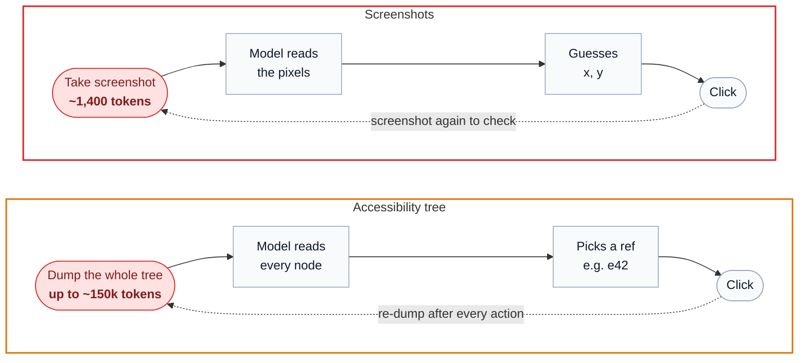
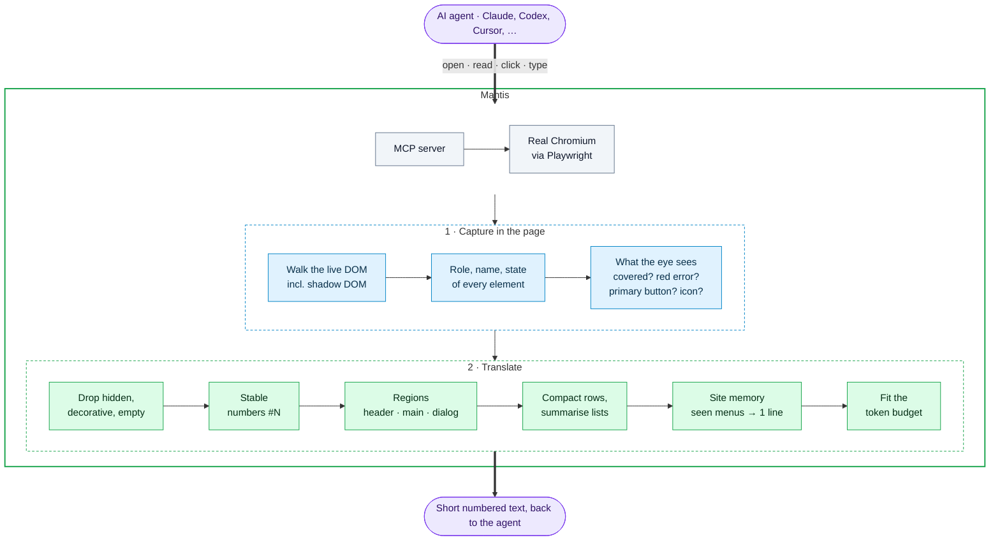
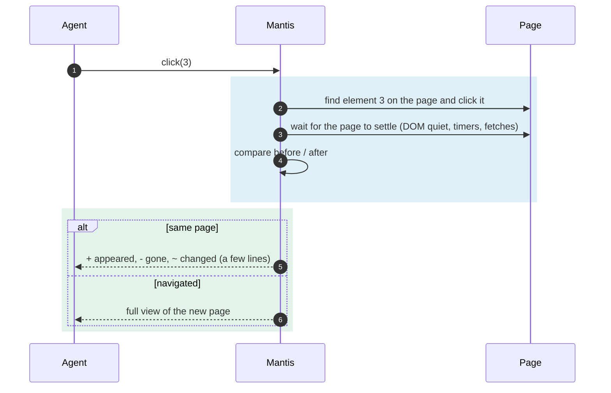
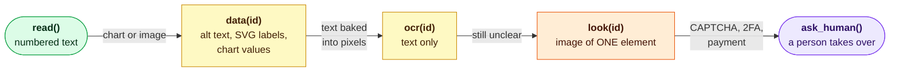

# Approach

How Mantis turns a web page into something an AI agent can read and act on, and why
it does this differently from the two ways agents browse today.

---

## 1. How agents browse today



**Screenshots.** The agent sees the page the way a person does, but every look costs
~1,400 tokens (1280×800), clicks are pixel guesses, and it needs another screenshot to
check what happened.

**The accessibility tree.** Browsers keep a second, text-only version of every page for
screen readers: each element as a *role* and a *name* (`button "Sign in"`,
`textbox "Email"`) plus states (`checked`, `disabled`). Tools such as Playwright MCP's
snapshot and browser-extension agents hand this tree, more or less as-is, to the model.
It is text, so it is cheaper than pixels and acts by reference instead of by
coordinate. But it has limits:

| The accessibility tree… | …so the agent |
|---|---|
| describes the DOM, not what is on screen | clicks a button hidden behind a cookie popup |
| depends on developers labelling things (many icon buttons have no name) | sees `button` with no idea what it does |
| only knows about errors/emphasis if the developer set ARIA for it | misses the red "Invalid email" text, can't tell the primary button |
| is the whole page, every time (a Wikipedia article: ~150k tokens) | burns context on pages it only needed to skim |
| has to be re-dumped after every action | re-reads the whole page to learn "a dialog opened" |
| has nothing for canvas / charts | can't read the numbers in a chart |

## 2. The Mantis approach

**Rule: Mantis = the accessibility tree + what a person would notice by looking − the noise.**
The accessibility tree is the floor, not the competition: Mantis must never lose
information the tree has, and must add what it lacks.



What the agent receives:

```
Page: Shop
[dialog "Accept cookies?" — covers page]
  #3 button "Accept"
  #4 button "Reject"
[main]
  # Shop
  #1 button "Add to cart" (covered)
  #2 button ~"trash"
```

### Acting: changes only



The agent never re-reads the whole page just to learn what one click did, and numbers
don't shift under it between steps.

### When text isn't enough: the fallback ladder



Cheapest first; the agent climbs only when it has to. Only `look` returns an image,
and never of the full page. Mantis never solves CAPTCHAs.

## 3. Mantis vs the accessibility tree

| | Accessibility tree | Mantis |
|---|---|---|
| Popup covering the page | not shown | `[dialog — covers page]`, items marked `(covered)` |
| Unlabelled icon button | `button` | `button ~"trash"` (`~` = inferred, never presented as fact) |
| Red error under a field | only if `aria-invalid` is set | `error: "Invalid email"` |
| Main call-to-action | looks like any button | `(primary)` |
| After a click | dump the whole tree again | only what changed |
| Element references | tied to a snapshot | stable `#N` while the element lives |
| Menus on page 2, 3, 4… | repeated in full | one line (site memory) |
| Charts / canvas | nothing | `data(id)` returns the numbers |
| Clickable only by script (`div` + click listener) | not shown | `clickable "Pro plan"` |
| Iframes (payment, login widgets) | per frame | inline under `[iframe "Payment"]`, own numbers |
| Size | whole page | budgeted, compacted |

**Measured:** the numbers are in the [README](../README.md#benchmark). How to read them:

- The replay's total-token gap is driven by a few huge pages, and on some of them Mantis shows a
  trimmed view while the tree sends everything. "Orients on the page cheaply" is fair; "reads the
  whole article cheaply" is not.
- Mantis used to fail 4 replay tasks because trimming hid what the agent needed. Now short text is
  kept, long lists name their items, and `find` reaches the rest. `test/coverage.test.ts` checks
  that every name in Chrome's accessibility tree is reachable through Mantis on 29 pages.
- With real agents, Mantis matches the tree on short tasks and uses fewer tokens on long ones,
  where every step re-reads more of the page.

## 4. Decisions along the way

- **No information loss.** Short standalone text (list items, status messages, footers) is kept;
  collapsed lists name their items; `find("text")` reaches anything trimmed. The coverage test runs
  on every test and benchmark page, and a change that breaks it does not ship, however many tokens it saves.
- **Speed.** The page scan returns one JSON string instead of Playwright's structured serializer
  (3x faster on big pages). When an in-page counter says nothing changed (DOM, scroll, input, focus,
  hover), the last scan is reused as the diff's "before". After an action Mantis waits 150 ms of DOM
  quiet; short timers and requests are tracked separately, so delayed effects are still caught.
- **Beyond the tree.** Elements made clickable only by script (a click listener, or where a pointer
  cursor starts) show as `clickable`, containers excluded. Visible iframes, cross-origin included,
  are read inline under `[iframe "title"]` with their own number range (`#10001…`).
- **Names from Chrome: tried, not shipped.** Chrome can give its computed name per element, but
  reading it made the scan ~25x slower (15 → 378 ms on a 200-link page). Mantis keeps its own name
  logic and the coverage test checks it against Chrome's names.

The test for every change: lose nothing the tree has, use fewer tokens, add meaning, don't get slower.
