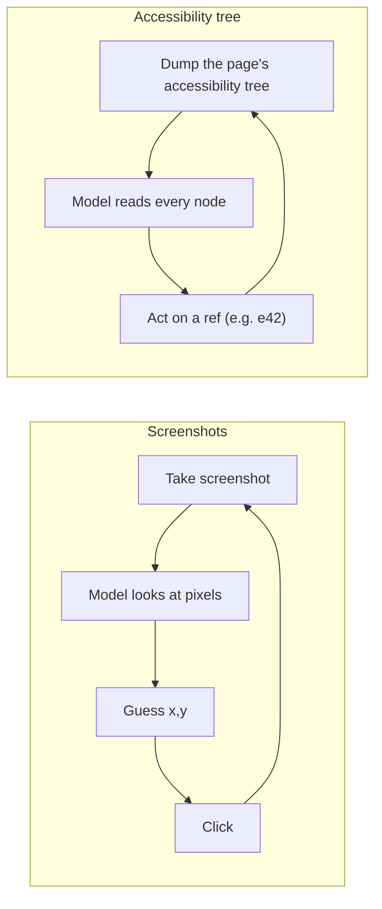
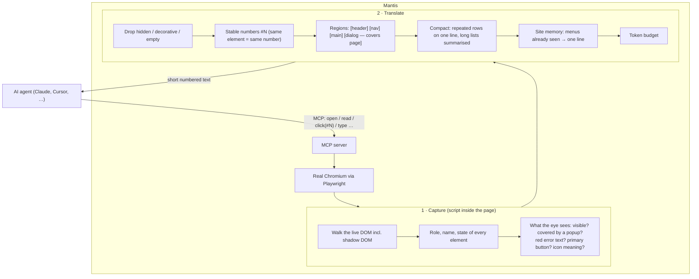
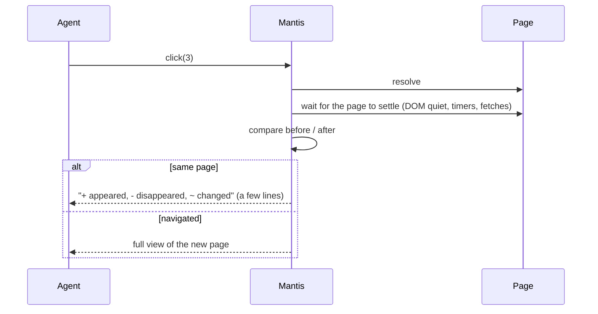
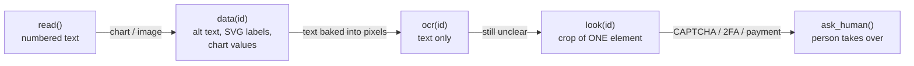
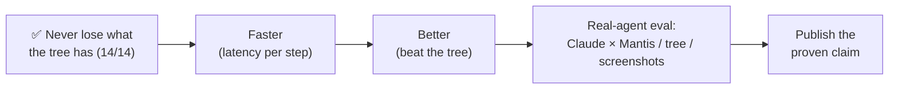

# Approach

How Mantis turns a web page into something an AI agent can read and act on, and why
it does this differently from the two ways agents browse today.

---

## 1. How agents browse today



**Screenshots.** The agent sees the page the way a person does, but every look costs
~1,400 tokens (1280×800), clicks are pixel guesses, and it needs another screenshot to
check what happened.

**The accessibility tree.** Browsers keep a second, text-only version of every page for
screen readers: each element as a *role* and a *name* (`button "Sign in"`,
`textbox "Email"`) plus states (`checked`, `disabled`). Tools such as Playwright MCP's
snapshot and browser-extension agents hand this tree, more or less as-is, to the model.
It is text, so it is cheaper than pixels and acts by reference instead of by
coordinate. But it has limits:

| The accessibility tree… | …so the agent |
|---|---|
| describes the DOM, not what is on screen | clicks a button hidden behind a cookie popup |
| depends on developers labelling things (many icon buttons have no name) | sees `button` with no idea what it does |
| only knows about errors/emphasis if the developer set ARIA for it | misses the red "Invalid email" text, can't tell the primary button |
| is the whole page, every time (a Wikipedia article: ~150k tokens) | burns context on pages it only needed to skim |
| has to be re-dumped after every action | re-reads the whole page to learn "a dialog opened" |
| has nothing for canvas / charts | can't read the numbers in a chart |

## 2. The Mantis approach

**Rule: Mantis = the accessibility tree + what a person would notice by looking − the noise.**
The accessibility tree is the floor, not the competition: Mantis must never lose
information the tree has, and must add what it lacks.



What the agent receives:

```
Page: Shop
[dialog "Accept cookies?" — covers page]
  #3 button "Accept"
  #4 button "Reject"
[main]
  # Shop
  #1 button "Add to cart" (covered)
  #2 button ~"trash"
```

### Acting: changes only



The agent never re-reads the whole page just to learn what one click did, and numbers
don't shift under it between steps.

### When text isn't enough: the fallback ladder



Cheapest first; the agent climbs only when it has to. Only `look` returns an image,
and never of the full page. Mantis never solves CAPTCHAs.

## 3. Mantis vs the accessibility tree

| | Accessibility tree | Mantis |
|---|---|---|
| Popup covering the page | not shown | `[dialog — covers page]`, items marked `(covered)` |
| Unlabelled icon button | `button` | `button ~"trash"` (`~` = inferred, never presented as fact) |
| Red error under a field | only if `aria-invalid` is set | `error: "Invalid email"` |
| Main call-to-action | looks like any button | `(primary)` |
| After a click | dump the whole tree again | only what changed |
| Element references | tied to a snapshot | stable `#N` while the element lives |
| Menus on page 2, 3, 4… | repeated in full | one line (site memory) |
| Charts / canvas | nothing | `data(id)` returns the numbers |
| Clickable only by script (`div` + click listener) | not shown | `clickable "Pro plan"` |
| Iframes (payment, login widgets) | per frame | inline under `[iframe "Payment"]`, own numbers |
| Size | whole page | budgeted, compacted |

**Measured so far** (deterministic replay, no LLM in the loop; Playwright MCP 0.0.83
stands in for the accessibility tree; full method in
[`bench/results/latest.md`](../bench/results/latest.md)):

| | Mantis | Accessibility tree (Playwright MCP) | Screenshots (est.) |
|---|---:|---:|---:|
| Median tokens per step | 28 | 131 | 1,366 |
| Median time per step, local pages | 247 ms | 315 ms | 1,066 ms |
| Tokens, all 14 tasks | 11,824 | 342,767 | 40,980 |
| Tasks completed | 14 / 14 | 14 / 14 | 14 / 14 |

Read this honestly:

- The **typical step is ~4.7× smaller** and a little **faster** (247 vs 315 ms on local pages;
  live pages add network time to both). The ~30× total is driven by a few huge pages, and on
  some of them Mantis shows a trimmed view while the tree sends everything.
- **Same tasks completed.** Mantis used to fail 4 because trimming hid what the agent
  needed; short text is now kept, long lists name their items, and `find` reaches the rest.
  A test (`test/coverage.test.ts`) checks that every name in Chrome's accessibility tree is
  reachable through Mantis on 29 pages.
- Whether an agent actually *succeeds* more often with Mantis is **not measured yet**.

## 4. Where we're going



Token cost is solved. Two things are not proven yet: **is it fast**, and **does an agent
actually succeed more often**. Work, in order:

**Done**

1. ✅ **No information loss.** Short standalone text (list items, status messages, footers)
   is kept; collapsed lists name their items compactly; `find("text")` reaches anything
   that was trimmed.
2. ✅ **A permanent check.** On every test and benchmark page, every name in Chrome's
   accessibility tree must be reachable through Mantis (`test/coverage.test.ts`). A change
   that breaks this does not ship, however many tokens it saves.

**Faster** (median per step on local pages: 360 → 208–247 ms; Playwright MCP 286–315 ms)

3. ✅ **Time every step in the benchmark**, next to tokens, for all three approaches.
4. ✅ **Cheaper page scan.** The scan result comes back as one JSON string instead of
   Playwright's structured serializer: 3× faster on big pages (Wikipedia 597 → 199 ms).
5. ✅ **One page scan per action, not two.** When nothing changed on the page since the last
   reply (an in-page counter of DOM changes, scroll, input, focus, hover), that scan is reused
   as the diff's "before" state.
6. ✅ **Shorter wait after actions.** 150 ms of DOM quiet instead of 300 ms; short timers and
   requests are tracked separately, so delayed effects are still caught.

**Better** (things the accessibility tree can't do, or does more correctly)

7. ✅ **Clickables made only by JavaScript.** Elements given a click listener in script, or
   where a pointer cursor starts (frameworks that listen once at the root), show as
   `clickable`. Containers are excluded. The tree doesn't show these at all.
8. ✅ **Iframes.** Visible frames, cross-origin included, are read inline under
   `[iframe "title"]`, with their own number range (`#10001…`).
9. ✗ **Names from Chrome — tried, not shipped.** Chrome can expose its own computed name
   per element (`computedName`), but reading it made the scan ~25× slower (15 → 378 ms on a
   200-link page). Mantis keeps its own name logic; `test/coverage.test.ts` checks it
   against Chrome's names on every test page instead.

**Then**

10. **Real-agent eval.** Success rate, steps, total tokens, time and cost for Claude with
    each of the three approaches, several runs per task, failures published. Start with a
    small pilot to measure usage before the full run.

The test for every change: **lose nothing the tree has · use fewer tokens · add meaning ·
don't get slower.**
